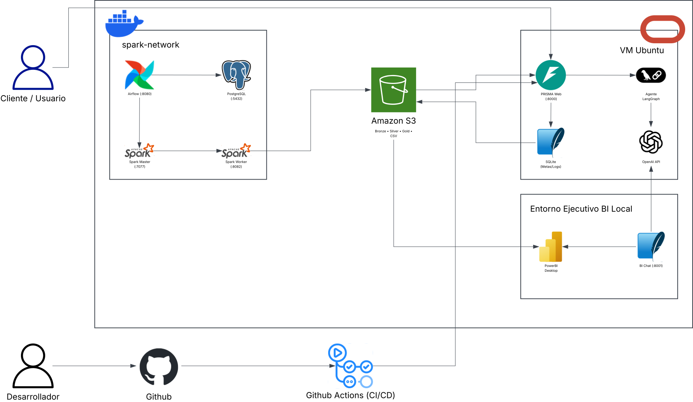
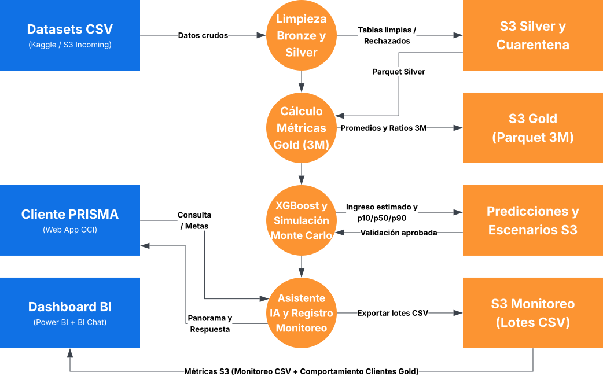

# 4. Diagramas de Solución y Flujo de Datos End-to-End — BBVA PRISMA

## 4.1 Diagrama de Arquitectura de Infraestructura

El diagrama de arquitectura representa los tres entornos de ejecución del sistema, su comunicación a través de **Amazon S3** y los flujos de usuario y despliegue continuo:

### 1. Actores Externos y Flujo CI/CD

- **Cliente / Usuario:** accede desde su navegador directamente a **PRISMA Web (`:8000`)** alojado en la máquina virtual de Oracle Cloud (OCI).
- **Desarrollador ➔ Github ➔ Github Actions (CI/CD):** al enviar cambios al repositorio en GitHub, los workflows ejecutan las pruebas automatizadas (`ci.yml`) y despliegan automáticamente la aplicación hacia **PRISMA Web (`:8000`)** en la **VM Ubuntu** (`cd.yml`).

### 2. Clúster Local ETL en Docker (`spark-network`)

Definido en `docker/docker-compose.yml` sobre una red bridge interna:

- **Airflow (`:8080`):** orquesta la cadena diaria de DAGs (`bronze_cleaning_pipeline` ➔ `silver_cleaning_pipeline` ➔ `gold_analysis_pipeline`), almacena sus metadatos de ejecución en **PostgreSQL (`:5432`)** y envía los trabajos de procesamiento a **Spark Master (`:7077`)**.
- **Spark Master (`:7077`) y Spark Worker (`:8082`):** ejecutan de forma distribuida las transformaciones PySpark de las capas Medallion y escriben los resultados directamente en **Amazon S3**.

### 3. Almacenamiento Central (`Amazon S3`)

- Actúa como el **Data Lakehouse** desacoplado que concentra las capas **Bronze • Silver • Gold** en formato `.parquet` y los lotes históricos de telemetría en formato **CSV** (`history/assistant_interactions/`).
- Alimenta de forma simultánea a **PRISMA Web (`:8000`)** en OCI y a **Power BI Desktop** en el entorno ejecutivo.

### 4. Nube de Producción en Oracle Cloud (`VM Ubuntu`)

- **PRISMA Web (`:8000`):** backend FastAPI y frontend del gemelo digital financiero.
- **Agente LangGraph:** procesa las consultas financieras del cliente invocando herramientas en Python y consumiendo **OpenAI API**.
- **SQLite (`Metas/Logs`):** persiste localmente las metas de ahorro (`goals.sqlite3`) y la cola de telemetría (`monitoring.sqlite3`), cuyos lotes anonimizados se exportan periódicamente hacia **Amazon S3**.

### 5. Entorno Ejecutivo BI Local

- **Power BI Desktop:** consume directamente desde **Amazon S3** las tablas Gold de comportamiento transaccional y los lotes CSV de monitoreo del asistente.
- **BI Chat (`:8001`):** servicio local conectado a **OpenAI API** con guardrails de seguridad que se integra dentro de **Power BI Desktop** para responder preguntas sobre los indicadores del dashboard.

---

## 4.2 Diagrama de Flujo de Datos End-to-End (Data Lineage)

El diagrama de flujo de datos modela el linaje completo desde los archivos crudos hasta el consumo del cliente y del comité ejecutivo:

### 1. Limpieza Bronze y Silver

- **Entrada (`Datos crudos`):** parte de **`Datasets CSV (Kaggle / S3 Incoming)`** con los 5 archivos fuente (`users`, `cards`, `transactions`, `accounts`, `obligations_payments`).
- **Proceso (`Limpieza Bronze y Silver`):** estandariza textos, importes y tipos en Bronze (`bronze_cleaning.py`), deduplica registros por hash `SHA-256`, valida integridad referencial e imputa límites de crédito con KNN en Silver (`silver_cleaning.py`).
- **Salida (`Tablas limpias / Rechazados`):** persiste en **`S3 Silver y Cuarentena`** tanto las tablas válidas (`data/silver/*.parquet`) como los registros aislados en cuarentena (`data/silver/rejected/*.parquet`).

### 2. Cálculo de Métricas Gold (3M)

- **Entrada (`Parquet Silver`):** lee las tablas validadas desde **`S3 Silver y Cuarentena`**.
- **Proceso (`Cálculo Métricas Gold (3M)`):** ejecuta `gold_analysis.py --stage base`, calculando flujos netos mensuales, promedios móviles de 3 meses (`average_income_3m`), desviación estándar (`income_std_3m`), ratios financieros (`savings_rate_3m`, `debt_payment_ratio_3m`, `expense_to_income_ratio_3m`), variaciones de ingreso (`income_change_3m`) y estatus de salud financiera, suprimiendo datos sensibles (`CVV`, `card_number`).
- **Salida (`Promedios y Ratios 3M`):** almacena las tablas analíticas en **`S3 Gold (Parquet 3M)`**.

### 3. XGBoost y Simulación Monte Carlo

- **Proceso (`XGBoost y Simulación Monte Carlo`):** ejecuta `income_model.py` para estimar el ingreso del siguiente mes con XGBoost y `monte_carlo.py` para simular 2,000 trayectorias estocásticas a 1, 2 y 3 meses.
- **Intercambio con S3 (`Ingreso estimado y p10/p50/p90` ⇄ `Validación aprobada`):** guarda los artefactos en **`Predicciones y Escenarios S3`** (`income_predictions.parquet` y `monte_carlo_scenarios.parquet`) y ejecuta `gold_analysis.py --stage predictions`, que audita rangos y tipos antes de devolver la **`Validación aprobada`** e integrarlos al resumen final del cliente.

### 4. Asistente IA, Registro de Monitoreo y Consumo en Dashboard BI

- **Interacción con el usuario (`Consulta / Metas` ⇄ `Panorama y Respuesta`):** el **`Cliente PRISMA (Web App OCI)`** consulta su panorama financiero, simula escenarios o registra metas de ahorro ante el proceso **`Asistente IA y Registro Monitoreo`**, protegido por guardrails de entrada y salida.
- **Telemetría (`Exportar lotes CSV`):** cada interacción finalizada exporta sus métricas operativas anonimizadas (latencia, estado HTTP, uso de herramientas, tokens y costo en USD) hacia **`S3 Monitoreo (Lotes CSV)`**.
- **Consumo Ejecutivo (`Métricas S3 (Monitoreo CSV + Comportamiento Clientes Gold)`):** el **`Dashboard BI (Power BI + BI Chat)`** consume desde S3 tanto los lotes de monitoreo como los indicadores Gold de 3 meses para la toma de decisiones ejecutivas.
